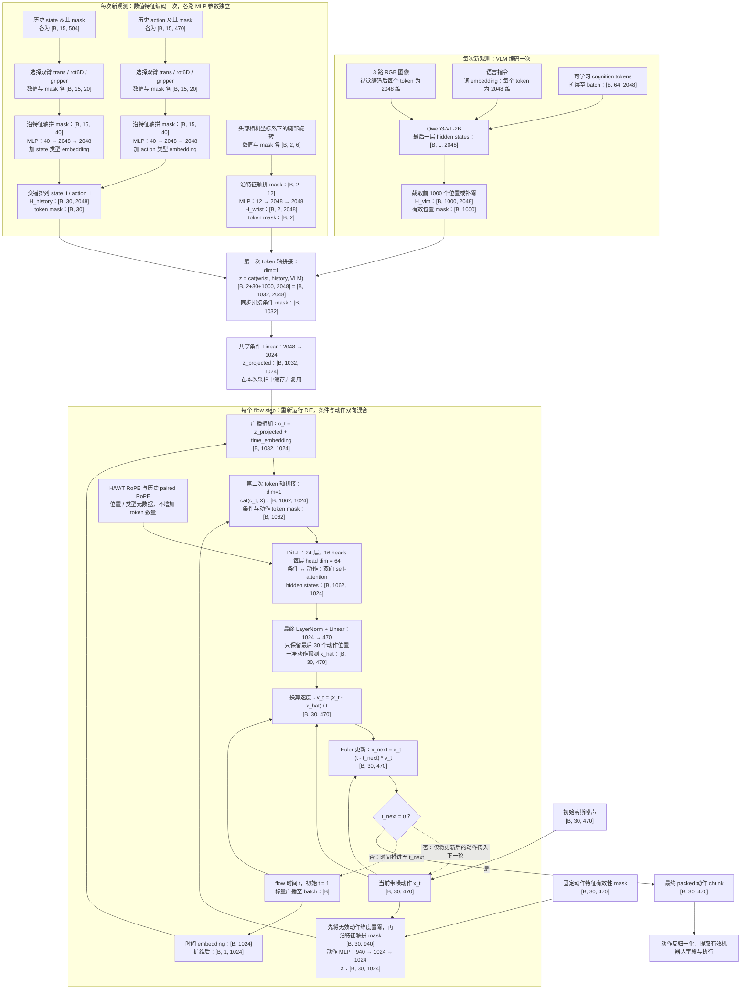

使用 VR 控制 Unitree G1 的上半身，采集了 2k 条 "pick and place" 数据，下一步就是训练 VLA。

支撑 VLA 使用的前提是：能支持使用位置控制的方式操作。实现这个得益于手臂的重力补偿（支持位置控制的根基），以及动态 $k_p$ 和摩擦力补偿（实现精细操作）。但是阻抗控制的机器人依然有一个很大的问题：惯性，这会导致机器人不稳，比如操作时会晃。

不管怎么样，先试试！

## CogACT
算法是 VLM + 扩散模型，建立在老师的预训练模型基础上。由于数据较少，使用 Lora 进行微调。下面展示的是最终改动的结果。

### 推理架构
`B` 是 batch size，`L` 是 VLM 输入序列长度。Qwen3-VL-2B 的语言 hidden size 为 2048，DiT-L hidden size 为 1024。



**图例：** 实线表示数据流；虚线表示 flow matching 采样的循环反馈。每轮只使用当前时间，不会在 `t = 0` 再计算速度。

### 维度与拼接说明

| 阶段 | 逻辑张量形状 | 操作 |
|---|---|---|
| VLM 条件流 | `[B, 1000, 2048]` | 已编码特征，截取/补齐 |
| 历史 state/action 条件流 | `[B, 30, 2048]` | 两路独立 MLP，加入类型 embedding，交错排列 |
| 腕部旋转条件流 | `[B, 2, 2048]` | 独立 MLP |
| 拼接后的观测条件 `z` | `[B, 1032, 2048]` | 沿 token 轴拼接，不是沿特征轴拼接 |
| 缓存的条件投影 | `[B, 1032, 1024]` | 共享 Linear 映射到 DiT hidden size |
| 当前时间条件 `c_t` | `[B, 1032, 1024]` | 广播加入时间 embedding |
| 带噪动作加特征 mask | `[B, 30, 940]` | `470` 维动作与 `470` 维 mask 沿特征轴拼接 |
| 动作 embedding | `[B, 30, 1024]` | 动作 MLP |
| DiT 联合序列 | `[B, 1062, 1024]` | `1032` 个条件位置与 `30` 个动作位置沿 token 轴拼接 |
| 干净动作预测与采样结果 | `[B, 30, 470]` | 仅输出动作位置 |

### 关键说明
- **VLM 与动作网络串联。**先运行完整 VLM，再将最后一层特征交给独立 DiT；两者不是逐层 attention 连接。
- **不只使用 cognition tokens。**当前 `only_use_cognition_token_as_input=false`。VLM 条件序列截取或补齐到 1000 个位置；若原序列更长，尾部 tokens 可能被截断。
- **普通 current-state 分支关闭，但仍有数值状态条件。**当前配置启用了历史 state/action 和腕部旋转，注入 action head。
- **拼接不等于已经融合。**数值 MLP 先将原始数值编码到与 VLM 相同的维度，拼接只增加 token 数量；随后 DiT 的各层 attention 才进行跨来源特征混合。
- **“固定”只针对本次采样的观测条件。**每轮从相同的 `z_projected` 开始，加上当前时间 embedding，与更新后的带噪动作重新运行 DiT。条件侧 hidden states 会在 DiT 内被更新，但不会传到下一轮；跨轮传递的是采样更新后的动作。
- **循环复用 VLM 输出，不复用 DiT 的逐层条件 K/V。**DiT 中条件与动作双向交互，且当前时间 embedding 加到条件流上，因此每个 flow step 都重新运行 DiT 的条件与动作序列。
- **时间方向为噪声到数据：`t = 1 → 0`。**训练时使用 `x_t = (1 - t) * x + t * noise`，预测干净动作；推理时将该预测换算成速度后积分。采样步数由推理参数指定。
- 当前配置动作频率为 10 Hz，chunk 长度为 30；一次实际执行多少步由控制端策略决定。


## 云资源使用

### 申请 SC card 与登录
1. 去 [CoreIdentity](https://coreidentity.microsoft.com) 点击 `Create SC-ALT Account`。会得到一个编号，形如 `sc-xxxxxx`，这个编号对应一个邮箱：`sc-xxxxxx@microsoft.com`，和员工邮箱是独立的
2. 在 [GSAM](https://aka.ms/GSAMssp) 申请实体卡片
3. 根据 [Unblocking SC Card](https://microsoft.sharepoint.com/sites/Identity_Authentication/SitePages/MicrosoftPINTool/Unblock-Your-Smart-Card-PIN-with-PIN-Tool.aspx) 的指引完成卡片的解锁。同时还需要一个物理读卡器，可以借一个，后续第一次认证完后凭证会保存在电脑上，之后就不需要了
4. 下载 `Azure CLI`，执行 `az login`，使用 SC 账号登录。登录一次可以用很久。

### 云存储
在使用云算力的时候，输入和输出需要从云存储中读取和写入。首先需要安装 `Microsoft Azure Storage Explorer`，登录的时候选择 `use a different account`，然后使用 SC card 对应的邮箱登录即可。

然后找到一个文件夹，比如
```
Subscriptions
    ConceptGraph - NLC - MSRA (sc-xxxxx@microsoft.com)
        Storage Accounts
            eaidatashare
                Blob Containers
                    <创建自己的文件夹，后面用"myfolder"代替>
```

> `Storage Account` 可以理解为云存储中的一个独立空间，类似于本地的硬盘分区。

之后写 `job.yaml` 的时候，就可以指定挂载这个文件夹作为输入或输出路径了，比如：
```yaml
storage:
  <随便起名>:
    storage_account_name: eaidatashare
    container_name: myfolder
    mount_dir: /mnt/<挂载后的目录名，后面用"myfolder_mounted"代替>
```

在云端执行 `ls /mnt/myfolder_mounted` 相当于在云存储中查看 `myfolder` 文件夹的内容。

往云存储中存储大量数据，走UI是很慢的。此时应该使用 `azcopy`（需要安装）。此时就可以把训练数据上传了。

### 看镜像里有什么
老师给了一个镜像，这是到时候云计算的时候要用的基础环境：
```yaml
environment:
    registry: eaiacr.azurecr.io
    image: aifx/acpt/stable-ubuntu2204-cu126-py310-torch28x:latest
```
要先看看里面有什么。

先加入 `docker` 用户组：
```bash
sudo usermod -aG docker "$USER"
newgrp docker
docker info
```
然后登录 ACR（这个镜像在 Azure Container Registry 中）：
```bash
az acr login --name eaiacr
```
然后拉取镜像：
```bash
docker pull eaiacr.azurecr.io/aifx/acpt/stable-ubuntu2204-cu126-py310-torch28x:latest
```
之后就可以为所欲为了！

### 提交任务
#### 1. 安装 AMLT
提交任务使用 `amlt`，应该在 linux 上安装（已经在win上踩了大坑）：
```bash
conda create -n amlt python=3.10
conda activate amlt
pip install -U amlt --index-url https://msrpypi.azurewebsites.net/stable/leloojoo
```

#### 2. 创建项目等配置
然后到使用的代码的目录下，创建一个项目：
```bash
amlt project create <project-name，后续用"myproject"代替> eaidatashare
```
这里 `eaidatashare` 对应前面挂载的 `eaidatashare` 存储账户。“项目”里会存储未来的实验和job。

> 更多的命令：
> - 删除 `amlt project remove <project-name> eaidatashare`
> - 查看项目列表 `amlt project list eaidatashare`

配置工作空间：
```bash
amlt workspace add eaiws --resource-group waiws --subscription <your-subscription-id>
```
这三个名字都是 Azure 上已经有的东西，其实建立了一个索引，让 AMLT 把 `<xxx>` 登记为“我可以使用的工作空间”。比如 `<subscription-id>`，就是上文 `ConceptGraph - NLC - MSRA (sc-xxxxx@microsoft.com)` 的 ID，可以在 `Microsoft Azure Storage Explorer` 中看到。

整个包含关系是反的：
```
Subscriptions
    Resource Groups
        Workspace
```

最终目标是定位到 `Workspace`，如果不传递后面的，AMLT 会搜索。

#### 3. 提交任务
在编写好 `job.yaml` 之后（“怎么写”见后），就可以使用 AMLT 提交任务了：
```bash
amlt run ./job.yaml
```

### 任务配置
```yaml
# 使用什么计算服务
target:
    service: singularity    # 这是一个基于 Singularity 的计算服务，相比 Docker 更适合科研与高性能
    name: palisades33       # 和 `singularity` 服务对应的计算节点名称。可以用 `amlt target list singularity` 查看
    workspace_name: eaiws   # 对应前面配置的工作空间名称。可以用 `amlt workspace list` 查看可用的工作空间。

# 使用什么环境 前面说过了不再赘述
environment:
    registry: eaiacr.azurecr.io
    image: aifx/acpt/stable-ubuntu2204-cu126-py310-torch28x:latest

# 数据存哪里 前面说过了
storage:
    test:
        storage_account_name: eaidatashare
        container_name: myfolder
        mount_dir: /mnt/myfolder_mounted

# 要用到的代码
code:
    local_dir: "<代码的路径>"   # 提交任务后会把该目录下的代码上传到云端
    ignore:                    # 提交任务时忽略的文件或目录
        - "*.pyc"              # 也可以通过 .amltignore 文件来配置
        - "__pycache__"
        - ...

jobs:
    - name: train
      sku: "${实例}:${显存}G${要用几张}-${GPU型号}" # 可以用 `amlt ti singularity -v` 查看可用的
      priority: high
      sla_tier: Premium
      identity: managed
      command:
        - | # 这个管道符号是 YAML 中的多行字符串标记，表示后续的内容是一个多行字符串
          python train.py   # 这里写实际的训练命令#
      submit_args:  # 不知道是什么
          env:
             MKL_THREADING_LAYER: GNU
             _AZUREML_SINGULARITY_JOB_UAI: /subscription/<your-subscription-id>/resourceGroups/eaiws/providers/Microsoft.ManagedIdentity/userAssignedIdentities/eaiws4storage
```

### 加速技巧
云上使用 FSDP 训练。发现速度缓慢，进行了三个改进：
1. 把数据直接复制到GPU设备上。由于数据很少（只有5G），因此可行
2. 把视频的 GOP 减小，以减少解码开销。从原来的几乎整段，改为30（一秒）
3. 减小 batch size

三套组合拳下来，相同数据量的训练仅需原来的一半时间。


## 上机与改进
训练了 96k 步。首先发现对桌子的高度过拟合了。

### 很大的问题：每次执行的首帧都会跳动一下
首先排查是不是模型的问题。利用训练数据计算模型输出和 GT 值的差异：

| 机械臂 | 平均位置偏差 | 平均角度偏差 |
| --- | --- | --- |
| 左臂 | 3.148mm | 0.4373° |
| 右臂 | 3.086mm | 0.4440° |

然后计算每次输出的30个动作和实际的差异，但并没有发现靠前面的动作误差明显大于后面的动作。这说明模型没有问题。

然后排查模型执行端。没排查出什么，但是召开讨论的时候发现只有手伸向某个位置才会触发，接着又发现了一些现象：
- 在中心区域成功率很高
- 正中间远一些的地方会出现首帧跳动，第一帧向下
- 把物品抬高，也会出现首帧跳动，第一帧向后

至此可以推断出是 OOD，模型不知道如何处理这些位置；这是无法解决的。为了让动作连续，我试着加入历史。

### 加入上一次请求的1&30个动作
然而实际并没有发现和0历史有什么不一样。这说明历史可能并没有什么用处。

### 加入上一次请求的后15个动作&状态
考虑到阻抗控制的“误差驱动运动”特性，或许需要把执行情况加入。所以在历史目标外，还加入了此时的实际位置。不过考虑到一开始很有可能在加速，所以只取了后半段。但是实测也没显著作用（看不出来）。

### 增加 chunk 长度
最大的区别是把频率从 30Hz 降低到 10Hz，这样能覆盖更久远的未来。执行的时候依然插值到 30Hz。

之所以这么做，有两个考虑：
- 推理时间太长（采集数据到收到结果，延时将近1s），导致之前都只能一个一个chunk单独处理，chunk之间无法重叠。现在延长了chunk的长度，大约可以覆盖1s的动作，可以进行更加连续的动作
- 未来预测太短会导致原地踏步。之前只预测1s，对于交接这样的任务，会一直原地抖手，毫无进展。如果规划更长远一些，就不会出现这种情况。

此外，输入也有历史，采用了前15个历史动作和状态，有自己的位置编码。之所以敢用，是因为前面的实验已经证明

实际结果也表明，这是最好的策略。它是第一个可以处理交接手任务的模型，动作非常果断丝滑。虽然一次预测的时间变长了，但是由于可以使用 chunk 重叠，观测与决策的更新并没有落下。

实现上有几个细节：
1. 重叠动作中，新动作的权重应该从 0 逐渐增加到 1，而旧动作的权重则从 1 逐渐减小到 0。否则依然会出现跳动的问题
2. 重叠动作融合依然按照 10Hz 进行，只有执行的时候才插值到 30Hz
3. 指令发出后开始等待状态，用“发出后收到的第一个状态”为这个动作对应的状态。虽然和训练数据有些不匹配，但这是误差较小且容易实现的方案

### 完全 delta
这个策略是为了解决模型对桌子高度的过拟合问题，通过只预测动作的变化量，而不是绝对位置，从而使模型更加关注动作的相对变化，实现泛化性。为了摆脱对绝对位置的依赖，输入和输出都只包含相对变化量，而不包含绝对位置。

输出有两种选择：相邻action的差值，或者相对于请求时刻状态的变化量。考虑到误差和方差会累积，所以选择了后者。

类似的，输入的历史也有两种选择，但是考虑到这已经是既定事实，所以选择了相邻动作的差分作为历史输入。此外，输入删去了相机的内外参和当前绝对位置状态，即输入只包含相对历史、三张图片和文本指令。

训练时也进行了泛化性的强化：对历史进行随机 mask，以增强模型对不同历史信息缺失情况下的鲁棒性。

实测delta确实有缓解OOD问题的潜力，比如物品放在主视角边缘时，生成的动作比绝对位置更加靠近物体。但若涉及到成功率等，并没有显著的改进。

### 主视角裁剪
然而即使是 delta 输出，依然无法实现对高度的泛化。观察轨迹可以发现，一旦抬高物品，末端就会往物体在主视角中桌子上的投影移动（后下方）。这说明模型过度依赖主视角了。因此增加了主视角裁剪以破坏内参，从而无法直接从主视角中获取空间位置，强迫模型结合多个视角进行推理。

训练下来轨迹确实更加靠近了，但是依然没有解决对高度的泛化性。

### 真机在线学习（失败）
看模型经常因为OOD而失败，自然就有一个想法：能否利用在线学习让模型迅速适应新的环境？能否利用失败经历进行调整？于是我开始尝试在线学习。

这里面有很多问题，最开始困扰我的便是：VLA 这么大的参数量，而真机采集数据又很慢，如何进行高效的微调？于是 mentor 带我找到了 UniSteer 的作者。他们的成果是只要微调 noise 的分布即可：现在的 flow matching 是从多维标准高斯分布中采样的，只要调整最初 noise 的均值和方差，就可以引导出新的动作分布。具体做法是加一个均值预测和方差预测网络接在中途，预测当前状态下的 noise 分布参数。

随后我又阅读了一些文献，发现总是监督学习和强化学习并进：强化学习让模型可以自己陷入OOD的情况，而又因为动作空间很大，纯自行探索可能完全得不到正样本，所以需要监督学习引导正确的方向。最终形成早期人类引导、后期自主探索的后训练策略。

监督学习很好理解，但强化学习不好做。最大的困难在于，文献都是一次一个动作，而我们的VLA一次性输出三十个动作，这使得转移非常稀疏。我最开始的想法是利用末端的力传感器，由人掰着引导，力就作为惩罚信号，这样每个action都有反馈了。不过这丢失了力的方向，而力的方向本就蕴含着更新的方向的信息，那直接用力的方向更新不是更好吗？恍然大悟，这不就是监督学习吗？而文献里人工介入普遍使用的是“space mouse”直接接管，精准而高效；而我这里靠人掰着引导，一来费力气，二来不精准，三来还会晃动身体，除了直观一些，还不如直接使用“space mouse”。于是创新点-1。

关于监督学习，微调某个模块实现的是四两拨千斤，但并不能本质上提升模型的能力。我想，与其纠正模型，还不如自己直接从 OOD 的地方采集数据、加入样本、“全量”微调呢！毕竟实验了这么久，会在哪里失败，我也一清二楚了。说到底，还是数据分布不够丰富。想到这，我连在线引导的兴致都减退了。

思来想去，好像完全没有了创新点。最终决定尝试一下直接 RL，由我负责给每个 chunk 打分，把 noise 视为 policy，进行 REINFORCE（我认为这无需 critic 能快速验证可行性）。首先发现模型动作的方差特别小，失败一次，下一次还是同样的轨迹，几乎没有探索性。为了让模型快速改变动作，我从一开始的“收集满16个样本才更新”改为“每收集到一个样本就立即更新”，以让模型每次都用新的权重得到不一样的动作。然而这只让动作越来越差，我认为这是因为动作空间过大导致的，策略几乎不可能朝着正确的方向更新。最终一下午碌碌无为无能狂怒。